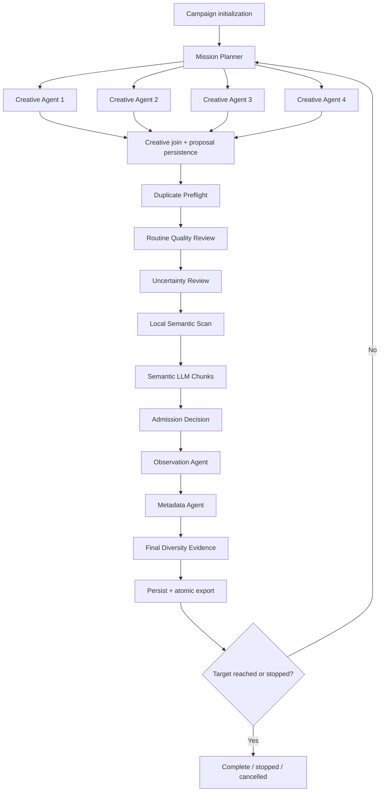

# ADK migration for Question Bank enrichment

> **Superseded on 2026-09-15.** This document is retained as historical v2/v2.1
> architecture. The validated n8n Question Bank v3 workflows are the sole
> production path for new campaigns. The ADK Web entry point is disabled by
> default and requires `QUESTION_BANK_ENABLE_LEGACY_ADK=1` for explicit legacy
> recovery.

## Outcome

Google ADK 2 was the orchestration path for legacy Question Bank campaigns.
ADK Web and the CLI invoke the same explicit graph. Existing Python modules remain
authoritative for provider calls, budgets, persistence, semantic and quality
rules, admission, review allocation, metadata, and exports. Historical unfinished
campaigns are outside this migration and will be addressed separately.

This is a direct cutover, not a shadow pipeline. Implementation may be delivered
in tested vertical slices, but no disposable prototype or second production
orchestrator is introduced.

## Operator contract

ADK accepts deterministic commands; an LLM never interprets spending authority:

```text
generate campaign=<id> proposal_target=<multiple-of-20> level=<mixed|shallow|deep> bank=v2.1 budget_usd=<positive-decimal>
status campaign=<id>
cancel campaign=<id>
resume campaign=<id> budget_usd=<positive-decimal>
```

One ADK run represents one complete campaign. `proposal_target` means generated
proposals processed, not unique or Staged Questions. The UI reports generated,
unique, Staged, review, rejected, and unresolved counts separately.

Cancellation is cooperative: finish or classify the active provider attempt,
persist its accounting, and start no further paid attempt. Resume is application
level and starts a new ADK invocation backed by SQLite. It reuses completed work
and requires fresh explicit authorization for new or uncertain provider work.
Closing the browser must not stop a campaign while the local ADK server remains
running. ADK Web hands Generate and Resume to a server-owned execution session
and returns its session ID immediately; Status and Cancel remain direct operator
commands. If the server stops, the durable application-level resume path applies.

## Executable workflow

The ADK graph exposes these named components and their structured input, output,
status, route, duration, and sanitized errors:

1. Campaign initialization
2. Mission Planner
3. Creative Agent 1
4. Creative Agent 2
5. Creative Agent 3
6. Creative Agent 4
7. Creative join and proposal persistence
8. Duplicate Preflight
9. Routine Quality Review
10. Uncertainty Review, conditional
11. Local Semantic Scan
12. Semantic LLM Chunks, conditional and sequential
13. Admission Decision
14. Observation Agent, advisory
15. Metadata Agent
16. Final Diversity Evidence
17. Persist and Export
18. Next Batch or Complete



Only the four creative agents run concurrently, with maximum concurrency four.
All quality, semantic, admission, metadata, Observation, export, and campaign-batch
work is sequential. A failed creative agent does not discard unaffected creative
outputs. A failed semantic chunk preserves earlier completed chunks and affects
only dependent candidates. An ordinary Observation failure is advisory, while
unknown spend or exhausted authorization prevents another paid call. Integrity, budget,
configuration, or persistence failure stops safely. Human-review candidates are
persisted asynchronously and never pause campaign execution.

ADK session state contains lightweight identifiers and progress only: campaign
ID, current batch, proposal target, generated and outcome counts, remaining
budget, active stage, run ID, and status. Question text, decisions, invocations,
costs, and review records remain authoritative in the existing Question Bank
SQLite database. ADK uses persistent local SQLite sessions for event history.

For ADK Web, run:

```bash
export QUESTION_BANK_ROOT=storage/question_bank_v2.1
export QUESTION_BANK_EMBEDDING_CHECKSUM=<verified-checksum>
.venv/bin/adk web --session_service_uri=sqlite:///storage/question_bank_v2.1/.adk/web-sessions.sqlite3 question_bank
```

The `question_bank.campaign` wrapper and `question-bank campaign-command` use
the same production graph as ADK Web. Web adds only the server-owned dispatch
boundary needed to survive a browser disconnect.

Campaign ownership is protected by a renewable SQLite execution lease. Every
workflow event carries its execution token, stale graphs fail closed, and Resume
atomically checks the pinned configuration before adding authorization. Interrupted
active reservations become Unknown Spend before a continuation starts. Proposal
rows and `generated_count` advance in one transaction, and automated resume never
reprocesses candidates already awaiting a human decision. Status includes
reconciled, active, unknown, and remaining USD.

## Provider and cost contract

ADK nodes call the existing native provider invocation boundary; ADK does not use
LiteLLM or replace the native OpenAI and Gemini adapters. Prompts, schemas, model
selection, thinking levels, token limits, model identity checks, retry rules, and
configuration hashes remain in the versioned Agent Configuration.

All Question Bank Gemini roles use `gemini-3.5-flash-lite`. The four creative
roles and `observed_diversity` use high thinking. Future Gemini roles must declare
their thinking level explicitly. Confirmed 503 fallback order is:

```text
gemini-3.5-flash-lite
gemini-3-flash-preview
gemini-3.6-flash
gemini-3.5-flash-lite
```

Each fallback attempt receives a model-specific reservation and its own trace.
The current list-price bounds are `$0.008900` per creative Lite attempt and
`$0.011800` per Observation Lite attempt. The configuration manifest and
execution version change, but the bank remains v2.1 and existing records are not
rewritten.

## Observability contract

The workflow observability boundary owns campaign, batch, and stage spans. The
existing provider boundary owns detailed LLM attempt spans. They share trace context and export one
nested trace to Phoenix without duplicate model spans. ADK Web shows component
flow and stage I/O; Phoenix shows the exact credential-free logical SDK request,
parsed response, model identity, tokens, cost, latency, fallback attempts, and
sanitized errors. SQLite is the durable audit and accounting authority. Neither
surface records credentials or private chain-of-thought.

## Direct-cutover gate

The migration is complete only when:

- all existing Question Bank tests pass;
- public ADK command, workflow, persistence, and control tests pass;
- scripted-provider tests cover every node and route without API spending;
- interruption, resume, cancellation, budget exhaustion, unknown spend, Gemini
  503 fallback, partial semantic failure, and atomic export are verified;
- ADK Web displays every named component and persistent event history;
- Phoenix displays one correctly nested workflow with exact provider I/O;
- existing CLI generation commands invoke the same ADK workflow and cannot call
  the legacy orchestrator directly;
- closing and reopening the browser does not terminate a server-owned campaign;
- one real 20-proposal Flash-Lite campaign succeeds under a `$0.25` cap and its
  admission rate, repetition, Shallow depth, and mission diversity are inspected;
- README and workflow documentation describe the executable system; and
- no existing Question Bank record is changed by the migration itself.

The paid acceptance campaign requires a separate explicit user authorization. It
is an acceptance run of the production workflow, not a prototype.
