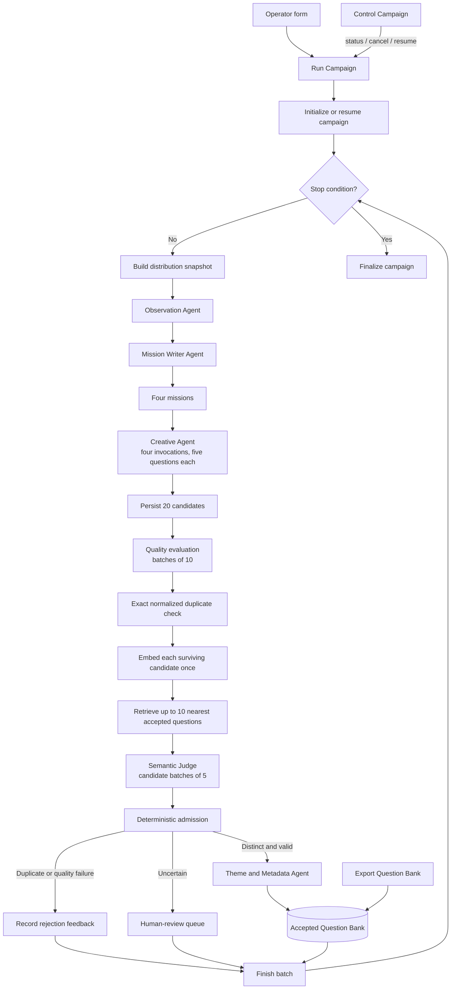

# Question Bank v3: n8n migration plan

Status: implementation complete as an inactive draft. Database contracts,
prompt and runtime registries, provider-attempt runtimes, explicit fallback and
retry paths, role wrappers, full campaign and batch orchestration, campaign
controls, CSV export, and the shared error-handler draft have been created. All
38 checked-in workflow definitions pass n8n SDK validation, saved connections
for the new orchestration workflows were read back and inspected, and the SQL
contract suite passes. Credential binding, pinned non-paid execution tests,
shared error-handler publication/attachment, and the explicitly authorized paid
qualification campaign remain before production cutover.

This plan replaces the proposed ADK production path for new Question Bank
generation. It also supersedes the earlier n8n feasibility recommendation that
n8n should call the existing Python engine. Question Bank v3 starts with an
empty bank and is implemented directly in n8n with native Gemini, OpenAI,
OpenAI Embeddings, and PostgreSQL nodes.

The purpose of the migration is to make the entire multi-agent flow visible and
editable in the n8n canvas while preserving hard spending limits, durable
campaign state, individual question validation, and full prompt/output traces.

## Vocabulary

- **Campaign**: one operator-launched job, such as “create 100 accepted Shallow
  questions under a $6 budget.” A campaign ends when its accepted target is
  reached, its budget is exhausted, it is cancelled, or a terminal system error
  occurs.
- **Batch**: an internal group of 20 candidates. A campaign may run multiple
  batches. The operator does not create or manage batches.
- **Candidate**: every proposed question, including questions later rejected or
  sent to review.
- **Question**: a candidate admitted to the accepted Question Bank.

The generation system must not use the word `round`. In the gameplay domain,
“round” retains its existing unrelated meaning.

## Scope

### Included

- a new empty Question Bank v3;
- native n8n orchestration and provider invocations;
- a visible multi-agent canvas with inspectable agent inputs and outputs;
- dynamic missions and iterative diversity feedback;
- individual quality, duplicate, and metadata decisions;
- exact-normalized duplicate rejection and pgvector nearest-neighbour retrieval;
- a hard campaign budget with reserve, reconcile, and unknown-spend states;
- durable prompt, attempt, candidate, question, campaign, and review records;
- generate, status, cancel, resume, and CSV export workflows; and
- one real 20-accepted-question qualification campaign before cutover.

### Excluded from the initial migration

- importing Question Bank v2 or v2.1;
- using the old evaluation corpus;
- runtime question sampling or adaptive retrieval;
- gameplay usage statistics influencing generation or admission;
- persistent semantic clustering;
- automatic taxonomy evolution;
- a dedicated human-review UI; and
- queue-mode or parallel Creative execution unless sequential execution is
  measured and found inadequate.

Existing banks remain unchanged and read-only. They may be imported later by a
separate, explicit migration.

## Architecture



n8n is both the executable orchestrator and the daily observability UI.
PostgreSQL is the authoritative application store. Provider credentials are
stored only in n8n's encrypted credential system.

## Workflow inventory

All workflows live in one Question Bank folder/project and use the tags
`question-bank-v3` and, where appropriate, `subworkflow`.

### Operator workflows

1. **Run Question Bank campaign**
   - n8n Form inputs: campaign name, accepted target, level (`shallow`, `deep`,
     or `mixed`), budget USD, and optional notes.
   - For `mixed`, the accepted target is split exactly 50/50. After one level
     reaches its target, subsequent batches generate only the missing level.
   - Orchestrates batches until a stop condition is reached.

2. **Control Question Bank campaign**
   - Actions: `status`, `cancel`, and `resume`.
   - Status reads PostgreSQL and never calls a provider.
   - Cancel is cooperative: finish accounting for an active provider attempt,
     then start no new paid attempt.
   - Resume starts a new n8n execution from durable campaign state and requires
     a new positive spending authorization.

3. **Export Question Bank**
   - On-demand export from PostgreSQL.
   - Supports accepted questions or campaign candidates and filters by level,
     theme, state, and campaign.
   - PostgreSQL, not CSV, remains authoritative.

4. **Handle Question Bank workflow errors**
   - Published Error Trigger workflow for failures escaping normal branches.
   - Persists workflow, execution, campaign, node, and sanitized error details.
   - It reports failures but never automatically retries paid work.

### Agent subworkflows

Each named role is represented by a visible, stateless n8n role subworkflow.
Agent subworkflows have explicit typed inputs and outputs, no conversational
memory, and no authority to write accepted questions directly.

Implementation note for n8n 2.38.1: the native Gemini language-model subnode
used by an AI Agent does not expose a thinking control, while the native direct
Gemini node exposes `thinkingBudget` and raw usage. The role subworkflows
therefore call explicitly budgeted direct Gemini/OpenAI provider-attempt
workflows. They remain agents at the domain level and are grouped/named as such
on the canvas, while preserving high thinking, visible inputs/outputs, hard
budget reconciliation, and explicit retries. This is an intentional deviation
from requiring the literal n8n `AI Agent` node type.

1. **Observe Question Bank diversity**
2. **Write generation missions**
3. **Generate questions**
4. **Evaluate question quality**
5. **Escalate uncertain quality decisions**
6. **Judge semantic duplication**
7. **Assign themes and metadata**
8. **Repair structured agent output**

The repair role and budgeted provider routes are present in the draft. The paid
qualification gate must verify the malformed-output branch before cutover; no
hidden provider retry is permitted.

One reusable Creative Agent subworkflow is called once for each of four
missions. Do not duplicate four Creative workflow definitions.

### Deterministic/stateful subworkflows

1. **Reserve provider budget**
2. **Reconcile provider attempt**
3. **Record unknown provider spend**
4. **Load frozen prompt snapshot**
5. **Persist agent run**
6. **Normalize and preflight question**
7. **Embed and retrieve neighbours**
8. **Apply admission decision**
9. **Build bank distribution snapshot**
10. **Read and update campaign state**

These subworkflows hide PostgreSQL details behind typed domain contracts.

## Campaign and batch behavior

Every internal batch proceeds as follows:

1. Read the current accepted counts, budget state, and cancellation flag.
2. Build a frozen distribution snapshot from the accepted bank and recent
   generation performance.
3. Run Observation once.
4. Run Mission Writer once to produce four distinct missions for the required
   level or levels.
5. Invoke the reusable Creative Agent four times sequentially. Each invocation
   receives one mission and returns five questions.
6. Persist all 20 questions as separate candidates before validation.
7. Validate every candidate independently through quality, exact duplicate,
   embedding retrieval, semantic judgment, admission, and metadata.
8. Refresh accepted counts and distribution statistics after the whole batch
   finishes. The snapshot becomes evidence for the next batch; it cannot alter
   the current batch's instructions midway.

The visible campaign controls are target, level, budget, cancel, and resume.
There is no operator-facing maximum-batch field. A generous internal emergency
ceiling prevents an accidental infinite loop and produces a terminal
`safety_ceiling_reached` status rather than silently continuing.

Human-review and operationally unresolved candidates do not count toward the
accepted target. The campaign continues producing replacements while budget and
the emergency ceiling allow.

## Creative guidance

Creative prompts receive:

- the required level;
- one dynamically written mission;
- the current Observation report;
- definitions of the creative dimensions: aspect, scenario, perspective,
  answer space, and optional contrast; and
- the Shallow or Deep quality contract.

Creative prompts must not contain example questions, including the user's
earlier examples. Named themes are not generation requirements and are not
passed as quotas. A mission may include non-binding theme hints, but generation
is question-first and theme assignment happens only after admission.

Each mission and each Creative invocation must seek variety across aspect,
scenario, perspective, answer space, wording, and question form. The dimensions
are guidance, not a fixed Cartesian product.

## Agent roles and models

| Role | Provider family | Reasoning |
|---|---|---|
| Observation | Gemini Flash Lite | High |
| Mission Writer | Gemini Flash Lite | High |
| Creative | Gemini Flash Lite | High |
| Quality Judge | OpenAI GPT Mini | Medium |
| Quality Escalation | OpenAI GPT Mini | High |
| Semantic Judge | OpenAI GPT Mini | High |
| Theme and Metadata | OpenAI GPT Mini | Medium |
| Structured Output Repair | Same provider family as failed role | Lowest setting that passes schema reliability tests |

Implementation must bind exact model identifiers exposed by the connected n8n
instance instead of inventing identifiers in workflow JSON. Gemini `high`
thinking is mapped to the native node's supported thinking parameter and frozen
in the campaign prompt/configuration snapshot.

Gemini's provider waterfall applies only to a confirmed `503 UNAVAILABLE`:

1. primary Gemini Flash Lite;
2. first available approved Gemini Flash fallback;
3. second available approved Gemini Flash fallback; and
4. one final attempt on the primary.

Each step is a separate visible, reserved, and traced provider attempt. Other
errors do not automatically change models. OpenAI retries the same model once;
if that fails, affected candidates become operationally unresolved.

## Quality evaluation

Quality Judge processes candidates in groups of 10 but returns one independent
record per question. It evaluates:

- understandable, natural wording;
- one clear answer task;
- ordinary answerability;
- bounded openness;
- realism and safety;
- single-question structure; and
- correct level.

Shallow questions must be lightweight, low-pressure, and immediately
answerable. A generic poll-style question is acceptable. Deep questions must
invite a safe answer that reveals something personally characteristic about the
Storyteller.

The first pass uses medium reasoning. Only `uncertain` results are sent to the
high-reasoning Quality Escalation Agent. Quality failures are stored with stable
reason codes and summarized for the next Observation invocation.

## Duplicate evaluation and admission

1. Normalize case, whitespace, apostrophes, and punctuation.
2. Reject an exact normalized match without an LLM call.
3. Embed each remaining candidate once with `text-embedding-3-small` at 1536
   dimensions.
4. Search pgvector across all accepted questions, without a theme filter.
5. Retrieve up to 10 nearest questions. An empty new bank simply returns fewer
   neighbours, including zero.
6. Send candidates to Semantic Judge in groups of five. Each candidate retains
   its own neighbour list and independent verdict.
7. Semantic Judge returns exactly `duplicate`, `distinct`, or `uncertain`, plus
   matched IDs, dimension relations, stable reason codes, and a concise feedback
   note.

A duplicate means an existing question makes the candidate redundant because
its scenario, perspective, and likely answer space substantially overlap. A
shared theme or aspect alone is not enough.

- `duplicate` -> reject;
- `uncertain` -> human-review queue; and
- `distinct` plus passed quality -> admit.

Every admitted candidate is inserted into the accepted table immediately, with
the already-computed vector. Later candidates in the same campaign can retrieve
it. This replaces exhaustive pair scans and eliminates `pair_overflow`.

## Themes and metadata

Metadata runs only after admission and cannot reverse admission. A question may
receive zero, one, or multiple equal theme memberships. There is no primary
theme and no forced assignment.

The initial named themes are:

- Yourself
- Childhood
- Family
- Goals
- Work
- Love
- Friends
- Hobbies
- Travel

`Random` remains a wildcard for product sampling and is not stored as a theme
membership.

The stable distribution taxonomy is intentionally small:

- level;
- multi-label themes;
- question form: direct, hypothetical, memory, reaction, choice, or comparison;
- scenario present or absent; and
- contrast present or absent.

Aspect, scenario, perspective, answer space, and contrast descriptions remain
free text. The initial system does not maintain a controlled vocabulary or
semantic clusters for them.

## Global bank distribution statistics

Global bank statistics describe accepted questions; they do not impose quotas.
They provide evidence to Observation and an inspectable dashboard summary.

After each completed batch, PostgreSQL refreshes a snapshot containing:

- accepted totals by level;
- question totals and percentages for every multi-label theme;
- questions with no assigned theme;
- common theme combinations;
- question-form distribution;
- scenario and contrast presence;
- representative recent accepted questions;
- recent acceptance, quality-rejection, semantic-duplicate, uncertainty, and
  provider-failure rates;
- repeated rejection reason codes and concise feedback notes; and
- successful and repetitive recent missions.

Observation receives the all-time accepted-bank summary plus activity from the
five most recent completed batches, including earlier batches of the active
campaign. Percentages for multi-label themes do not need to add to 100%.

Semantic clusters are deliberately excluded. pgvector is used only to retrieve
nearest neighbours for duplicate judgment. If the bank later reaches a scale
where the existing feedback is insufficient, an optional offline workflow may
write cluster snapshots without entering the admission critical path.

## Prompt registry and execution traces

Editable prompt templates live in an n8n Data Table because they are small,
operator-visible configuration. Each entry has role, version, template, model
settings, output schema version, and status.

Starting a campaign freezes an immutable prompt/configuration snapshot. Resume
uses that snapshot; editing the registry affects only new campaigns.

PostgreSQL stores a durable `agent_runs` record for every invocation:

- campaign, batch, candidate, mission, and attempt identifiers;
- agent role and prompt version;
- fully rendered, credential-free prompt;
- raw response and parsed structured response;
- provider, requested model, and reported model;
- reasoning or thinking setting;
- input/output tokens and reconciled cost;
- fallback and repair relationships;
- start time, duration, status, and sanitized error.

n8n's execution inspector provides the visual input/output view. PostgreSQL
preserves the same evidence beyond n8n execution retention. Neither store may
contain API keys, transport headers, or private chain-of-thought.

Structured-output repair is explicit rather than an invisible parser retry. A
schema failure branches to the Repair Agent only after a new budget reservation
and creates its own trace. This intentional deviation prevents an automatic
paid call from bypassing campaign accounting.

## PostgreSQL data model

PostgreSQL with the pgvector extension is the single authoritative store.
Initial tables are:

- `campaigns`: requested targets, accepted progress, status, cancellation,
  prompt snapshot, authorized/spent/reserved/unknown USD, and timestamps;
- `batches`: campaign sequence, requested level mix, state, and distribution
  snapshot used;
- `missions`: Observation and Mission Writer outputs and their batch links;
- `candidates`: every proposed question, level, mission, state, decision codes,
  and stage results;
- `questions`: accepted candidates only, normalized text, level, embedding, and
  acceptance metadata;
- `themes` and `question_themes`: named themes and zero-to-many memberships;
- `provider_attempts`: reservation, reconciliation, usage, cost, fallback,
  idempotency, and unknown-spend state;
- `agent_runs`: sanitized prompt/output traces;
- `prompt_snapshots`: immutable campaign configuration;
- `review_queue`: uncertain question-specific decisions; and
- `distribution_snapshots`: frozen all-time and recent summaries consumed by
  Observation.

Database constraints enforce unique campaign IDs, unique attempt IDs, unique
normalized accepted text, and one accepted question per candidate. Admission
and budget changes use transactions.

## Hard budget accounting

Before every provider invocation, **Reserve provider budget** performs an atomic
conditional PostgreSQL update. Reservation succeeds only if:

```text
spent_usd + reserved_usd + unknown_spend_usd + attempt_reservation_usd
<= authorized_budget_usd
```

The provider is called only after reservation succeeds. Afterwards:

- successful usage reconciles reservation to actual cost;
- a definite pre-billing failure releases the reservation; and
- an ambiguous transport result moves it to `unknown_spend_usd` and stops the
  campaign.

Every attempt has an idempotent `attempt_id`. Native retry-on-fail is disabled
for paid AI and embedding nodes because hidden retries would bypass reservation
and tracing. Retry and fallback nodes are explicit in the canvas.

Budget exhaustion preserves all completed work and finishes the campaign as
`budget_exhausted_partial`. It never deletes accepted questions or fabricates
the missing target.

## Failure isolation

Candidate-specific failures do not discard unaffected candidates. They become
rejected, review-required, or operationally unresolved as appropriate.

A campaign stops for:

- hard budget exhaustion;
- unknown spend;
- database or transaction failure;
- operator cancellation;
- missing/invalid credential or model configuration;
- invalid frozen prompt/configuration snapshot; or
- the internal emergency batch ceiling.

All unattended production workflows use the shared Error Trigger workflow.
Provider failures are handled visibly inside the agent subworkflows whenever
possible so their attempt state and campaign consequence remain explicit.

## Migration sequence

### Phase 1: foundation

1. Provision PostgreSQL and enable pgvector.
2. Create the v3 schema, constraints, views, and atomic budget functions.
3. Create and bind native n8n credentials for PostgreSQL, OpenAI, and Gemini.
4. Create the prompt registry and initial immutable prompt versions.
5. Create the shared production error workflow.

### Phase 2: reusable subworkflows

1. Implement and test budget reserve/reconcile/unknown-spend operations.
2. Implement prompt loading, trace persistence, normalization, embedding/top-10
   retrieval, admission, campaign state, and distribution snapshots.
3. Implement the eight stateless Agent subworkflows with structured contracts.
4. Validate each workflow and verify its saved connections before publishing.

### Phase 3: campaign orchestration

1. Build the campaign form and initialization path.
2. Build the 20-candidate batch loop.
3. Add stop-condition, partial-preservation, and finalization branches.
4. Build status, cancel, resume, and export workflows.
5. Add canvas groups, concise descriptions, and warning stickies around paid
   calls and unknown-spend paths.

Implementation result: the launch form, initialization workflow, bounded
campaign worker, end-to-end batch orchestrator, and five independently visible
batch-stage subworkflows are created. Long workflows use explanatory canvas
notes; node-group polish is optional and does not affect execution.

### Phase 4: non-paid and pinned tests

1. Validate every workflow.
2. Read every saved workflow back and inspect connections and credential IDs.
3. Test deterministic paths with pinned data: exact duplicate, quality reject,
   semantic duplicate, distinct admit, uncertainty, cancellation, insufficient
   budget, repair, provider failure, and unknown spend.
4. Confirm agent input and output are visible in n8n and durable in PostgreSQL.

### Phase 5: paid qualification and cutover

1. After explicit authorization, run one real campaign targeting 20 accepted
   questions with a small hard budget.
2. Verify accepted count, individual decisions, prompt traces, usage/cost
   reconciliation, nearest-neighbour evidence, theme metadata, controls, and CSV
   export.
3. Make n8n the only production owner for new campaigns.
4. Disable the ADK production entry point and Phoenix-by-default path without
   deleting historical code or old banks.
5. Update the README and active operating documentation to point to n8n.

## Qualification criteria

Cutover requires all of the following:

- the campaign reaches 20 accepted questions or reports an accurate partial
  result caused by its explicit budget;
- every saved candidate has an individual terminal or review state;
- accepted-bank count equals the `questions` table count;
- exact duplicates make no semantic LLM call;
- every non-exact semantic decision uses no more than 10 nearest accepted
  questions;
- same-campaign accepted questions are immediately retrievable;
- no provider call occurs without a successful budget reservation;
- actual cost, reservations, and unknown spend reconcile exactly;
- inputs, rendered prompts, outputs, models, usage, costs, repairs, and fallbacks
  are inspectable by agent invocation;
- cancelling starts no new paid attempt;
- resume does not repeat completed attempts or change the frozen prompt snapshot;
- no secret or private chain-of-thought appears in workflow JSON, execution data,
  PostgreSQL traces, or exports; and
- workflow validation, saved-connection verification, and representative tests
  pass before publication.

## Deferred enhancements

- dedicated human-review workflow or UI;
- controlled Creative concurrency or n8n queue mode;
- semantic-cluster snapshots;
- migration of selected v2/v2.1 questions;
- adaptive runtime sampling using gameplay statistics;
- a domain-specific embedding Recall@10 bake-off; and
- automatic taxonomy evolution.
