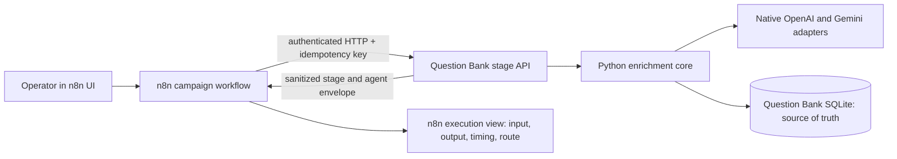
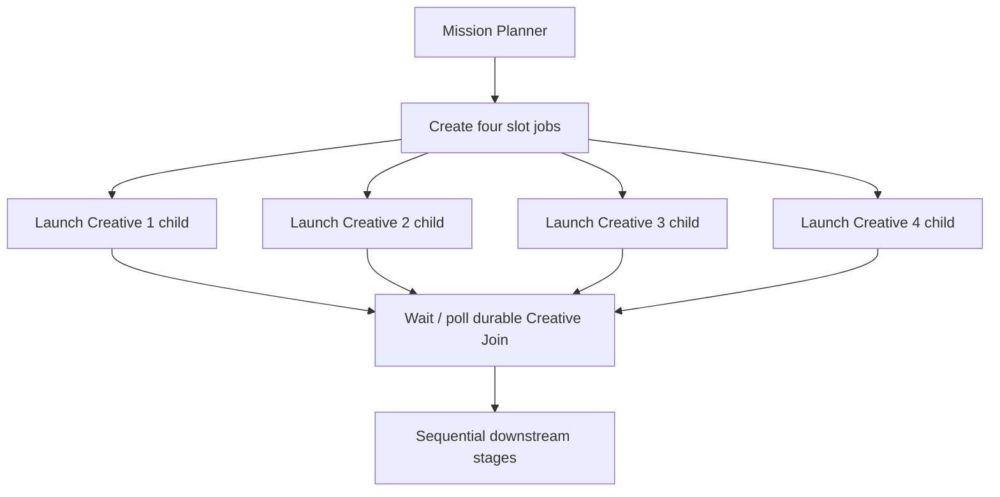

# Feasibility of n8n for Question Bank v2.1

> **Superseded:** This document records the earlier feasibility investigation.
> The approved architecture now builds Question Bank v3 directly in n8n with
> native provider nodes and PostgreSQL. See
> [Question Bank v3: n8n migration plan](../n8n-question-bank-v3-migration-plan.md).

Research date: 2026-09-13. Sources are limited to the repository and official
n8n documentation/source. This document evaluates n8n as a replacement for
Google ADK orchestration and, initially, Phoenix observability.

## Historical decision

**n8n is feasible and is probably a better operator interface for this project
than ADK Web.** It can replace ADK as the visual control plane and workflow
orchestrator. It can also replace Phoenix for the immediate requirement—click a
stage and inspect that agent's exact sanitized request and parsed response—if
the Question Bank backend deliberately returns those fields as node data.

The safe architecture is not “move all Question Bank code into n8n.” It is:

> **n8n owns the visible flow; the existing Python Question Bank core owns
> provider calls, prompts, schemas, cost authorization, retries/fallbacks,
> idempotency, admission rules, and persistence.**

This preserves the difficult correctness work already implemented while making
the flow editable and observable in a purpose-built UI. n8n should call a small
local HTTP API around the Python core. It should not call OpenAI/Gemini directly
in the first migration, write to the Question Bank SQLite database directly, or
use shell-command nodes to run the CLI.

The one important caveat is concurrency: four branches drawn side by side in an
n8n workflow are **not four concurrent tasks**. For workflows created in n8n
1.0 or later, n8n completes each branch in turn, ordered by its canvas position
([official execution-order documentation](https://docs.n8n.io/build/flow-logic/understand-execution-order)).
The current four concurrent creative agents therefore need an explicit fan-out
design, described below.

## What is being migrated

The current production contract in `docs/adk-question-bank-migration.md` has 18
named stages:

1. Campaign initialization
2. Mission Planner
3. Creative Agents 1–4
4. Creative join and proposal persistence
5. Duplicate Preflight
6. Routine Quality Review
7. Uncertainty Review
8. Local Semantic Scan
9. Sequential Semantic LLM Chunks
10. Admission Decision
11. Observation Agent
12. Metadata Agent
13. Final Diversity Evidence
14. Persist and Export
15. Next Batch or Complete

Only the four creative agents run concurrently. All later paid and deterministic
stages run sequentially. The Python implementation already contains the hard
invariants n8n must not dilute:

- a campaign-scoped dollar authorization and attempt limit;
- reserve/reconcile/unknown-spend accounting for every provider attempt;
- provider-specific models, thinking levels, structured schemas, timeouts,
  retry rules, and Gemini fallback order;
- idempotency keys and an execution lease;
- atomic proposal persistence and generated-count advancement;
- partial-result preservation when a creative agent or semantic chunk fails;
- semantic comparison, admission, human-review, metadata, and export rules; and
- application-level cancel/resume after process interruption.

These are domain behavior, not generic workflow behavior. They should remain in
`question_bank/engine.py`, `question_bank/store.py`, `question_bank/providers.py`,
and the production stage backend, regardless of the visual orchestrator.

## Recommended architecture



n8n is the control plane. The Python API is the execution and integrity plane.
SQLite remains the durable domain and accounting authority. n8n's own database
stores workflow definitions and a human-friendly copy of execution data; it
does not become the Question Bank database.

For the first parity migration, keep the current prompt templates and response
schemas in Python. After parity, selected prompt fields can become editable n8n
node inputs without moving trust into n8n: the backend must validate the prompt
configuration, calculate and persist its version/hash, render the final logical
request, and refuse an unversioned or schema-incompatible override. This gives
the operator UI control over prompt development while model allowlists, output
contracts, retry policy, and spending authority remain protected by the core.

Two existing implementation details require deliberate migration work:

- `ProductionWorkflowBackend` keeps the active `_BatchState` in memory. A stage
  API therefore needs to be a long-lived Python service for the first slice,
  and every stage still needs a durable/idempotent recovery path before n8n can
  safely resume after that service restarts. Merely exposing each current method
  as an unrelated serverless request would lose its batch state.
- The Question Bank database currently stores an invocation's `input_hash` and
  parsed response, not the full rendered provider request. The exact sanitized
  request currently exists at `render_provider_request()` and is sent to
  Phoenix. If Phoenix is disabled and n8n later prunes the execution, that exact
  prompt disappears. The migration must either retain selected n8n executions
  indefinitely or, preferably, add a bounded sanitized request envelope to the
  Question Bank invocation audit record. This is an audit/evidence extension;
  it must not contain credentials or private chain-of-thought.

### Node response contract

Every agent-stage API response should return a compact envelope so selecting
the corresponding n8n node shows what the user actually wants:

```json
{
  "campaign_id": "v21-shallow-100-...",
  "batch_index": 2,
  "stage": "creative_agent_3",
  "status": "succeeded",
  "agent_input": {
    "mission": {},
    "comparison_ids": []
  },
  "agent_request": {
    "provider": "gemini",
    "model": "gemini-3.5-flash-lite",
    "thinking_level": "high",
    "prompt_template_id": "...",
    "rendered_prompt": "...",
    "response_schema_id": "..."
  },
  "agent_response": {
    "parsed_output": {},
    "reported_model": "...",
    "usage": {},
    "cost_usd": "...",
    "fallback_attempts": []
  },
  "stage_output": {
    "candidate_ids": []
  }
}
```

It must never include credentials or private chain-of-thought. The existing
observability boundary already builds a credential-free logical request and
records parsed output, model, usage, cost, fallback attempt, and sanitized
errors, so this is primarily a new presentation boundary rather than a new data
model.

Keep payloads compact: carry candidate and comparison IDs between nodes, not the
entire bank or every embedding. This prevents n8n's execution database from
becoming an expensive duplicate of Question Bank storage.

## Fit against the requirements

| Requirement | n8n fit | Conditions |
|---|---|---|
| Visually see and edit the total workflow | Strong | The canvas is the executable workflow, not a separately generated diagram. Use named sub-workflows to keep the 18-stage flow readable. |
| See each agent's input, rendered prompt, and output | Strong with adapter | n8n shows saved execution data per node; the Python stage response must expose the sanitized request/response envelope. |
| Mixed Gemini and OpenAI roles | Strong through existing core | Keep native Python adapters and pinned Agent Configurations. |
| Four creative calls in parallel | Medium | Ordinary n8n branches are sequential; use asynchronous child executions plus a durable join, or retain Python fan-out. |
| Sequential semantic chunks | Strong | A normal chain or Loop Over Items node expresses this directly. |
| Reliable cost cap and unknown-spend handling | Weak natively; strong with current core | n8n is not the money ledger. Every paid call remains reserved and reconciled by Python. |
| Durable stop/resume | Medium natively; strong with current core | n8n can wait/retry/stop, but the campaign database must remain the resumable authority. |
| Partial failure without discarding good outputs | Strong with current core | Child results persist before the join; the core decides whether a missing result is unresolved or terminal. |
| Human review without blocking generation | Strong | Persist the review case in the core and continue; a separate review workflow can be added later. |
| Local/self-hosted operation | Strong | The free Community edition includes the core workflow editor, executions, queue mode, and most features. |
| Git-governed workflow changes | Medium on Community | Export workflow JSON to this repository; integrated Git environments require paid Business/Enterprise. |

## Visual editing and execution inspection

n8n workflows are built directly on a node canvas, and nodes can be renamed,
disabled, duplicated, individually executed, grouped, and converted to
sub-workflows. Sub-workflows accept declared inputs and can optionally make the
parent wait for completion
([Execute Sub-workflow](https://docs.n8n.io/integrations/builtin/core-nodes/n8n-nodes-base.executeworkflow)).
This is a materially better fit than an ADK trace graph when the goal is to move,
insert, replace, or temporarily disable stages in a UI.

Production executions are available from a workflow's Executions tab. n8n can
filter runs by status, retry a failed run with either the original or current
workflow, and load saved data from an old execution
([All executions](https://docs.n8n.io/workflows/executions/all-executions/)).
Registered Community instances can also copy a past execution into the editor
for debugging and pin its input
([Debug executions](https://docs.n8n.io/build/understand-workflows/understand-executions/debug-executions)).
This gives the desired click-through experience as long as the stage API returns
the agent envelope above.

This is basic execution observability, not a full LLM analytics product. n8n will
not automatically calculate cross-provider cost, compare prompt versions, or
build evaluation datasets for custom Python HTTP calls. Those remain available
from the Question Bank database and can be added to the node envelope or a later
dashboard if they become necessary.

## Concurrency design

### What does not work

Drawing Mission Planner with four outgoing branches and merging them later looks
parallel but runs those branches sequentially in current n8n. The generic Merge
node does not change that execution behavior.

### Recommended first design

Use four visible `Execute Sub-workflow` nodes to launch four **independent child
executions without waiting**. Each child invokes exactly one creative slot and
persists its result through the Python API. Then the parent enters a visible
`Creative Join` loop which queries the core until all four slots are terminal
(success, failure, or skipped), or until the campaign has been cancelled.



The Execute Sub-workflow node officially supports continuing without waiting
for completion. n8n queue mode uses Redis and workers to run multiple workflow
executions simultaneously; workers can each handle multiple simultaneous
executions and expose a configurable concurrency value
([Queue mode](https://docs.n8n.io/deploy/host-n8n/configure-n8n/scaling/enable-queue-mode)).
However, queue mode is operationally heavier and n8n recommends Postgres 13+
rather than SQLite for it. For a local four-call fan-out, first test asynchronous
child executions in regular mode. Add queue mode only if measured execution
shows the four provider calls are not overlapping reliably or larger scale is
needed.

The alternative is to let one Python `Creative fan-out` endpoint retain the
current `max_concurrency=4` behavior. That is simpler and safest, but n8n would
show one fan-out node containing four nested agent envelopes rather than four
independently active canvas nodes. It is a reasonable first vertical slice if
the asynchronous join delays migration.

## Reliability, retry, cancel, and resume

n8n provides useful generic mechanisms:

- `Retry On Fail` can automatically rerun a failed node
  ([node settings](https://docs.n8n.io/build/understand-workflows/workflow-components/work-with-nodes));
- error workflows receive failures and can notify or compensate
  ([error handling](https://docs.n8n.io/build/flow-logic/handle-errors-gracefully));
- a Wait node offloads execution state to the n8n database and reloads it when a
  timer or webhook resumes the run
  ([Wait node](https://docs.n8n.io/integrations/builtin/core-nodes/n8n-nodes-base.wait));
- the API has an `execution:stop` scope for stopping a running execution
  ([API authentication/scopes](https://docs.n8n.io/connect/n8n-api/authentication)); and
- workflow timeouts can be set globally and per workflow
  ([execution settings](https://docs.n8n.io/deploy/host-n8n/configure-n8n/basic-configuration/use-environment-variables/executions)).

They are not sufficient by themselves for paid LLM operations. If an HTTP
timeout or operator stop occurs after the provider accepted the request, n8n
cannot know whether money was spent. Retrying a failed workflow may also rerun a
paid node. Therefore:

1. Disable n8n's automatic retry on paid agent nodes.
2. Give every stage and provider attempt a deterministic idempotency key.
3. Let the Python core decide fallback/retry and reserve each possible attempt.
4. On an ambiguous transport failure, preserve the existing Unknown Spend state.
5. Make the n8n Cancel path call the Question Bank cancel endpoint first. The
   core cooperatively finishes or classifies the active provider attempt and
   starts no new paid work. Stopping the n8n execution alone is not cancellation
   authority.
6. Make Resume start a new n8n execution from the durable campaign status and a
   fresh explicit authorization. Do not depend on “retry workflow” as the
   campaign resume mechanism.

An error workflow should report the failure and campaign ID, but it must not
generate replacement questions or authorize more spend automatically.

## Provider integration: native nodes versus the Python core

n8n has official OpenAI and Gemini integrations. OpenAI node v2 supports the
Responses API, and the OpenAI Chat Model supports Responses plus JSON Schema and
reasoning controls
([OpenAI node](https://docs.n8n.io/integrations/builtin/app-nodes/n8n-nodes-langchain.openai),
[OpenAI Chat Model](https://docs.n8n.io/integrations/builtin/cluster-nodes/sub-nodes/n8n-nodes-langchain.lmchatopenai/)).
The Gemini Chat Model dynamically loads available models and documents maximum
tokens, temperature, top-k, top-p, and safety settings, but it does not document
a thinking-level control or the project's strict structured-response contract
([Gemini Chat Model](https://docs.n8n.io/integrations/builtin/cluster-nodes/sub-nodes/n8n-nodes-langchain.lmchatgooglegemini)).

Native nodes are attractive for quick experiments, but adopting them now would
move model feature support, retries, response parsing, usage normalization, and
reported-model validation out of the already-tested Python boundary. It would
also require rebuilding the Gemini 503 fallback and per-attempt reservations in
n8n. That adds correctness and cost risk without improving the canvas.

Use the HTTP Request node to call the local Python stage API instead. The node
can send and receive JSON and supports timeout/response controls
([HTTP Request node](https://docs.n8n.io/integrations/builtin/core-nodes/n8n-nodes-base.httprequest/)).
Avoid Execute Command: it is unavailable on n8n Cloud and disabled by default
in self-hosted n8n 2.x because of its security risk
([Execute Command](https://docs.n8n.io/integrations/builtin/core-nodes/n8n-nodes-base.executecommand/)).

The Question Bank's role-specific invocations can still correctly be called a
multi-agent system. They do not need to be n8n's tool-using “AI Agent” node.
Most roles here are one-shot, schema-constrained generators, classifiers, and
reviewers, for which a deterministic workflow plus native provider adapter is
more appropriate.

## Can n8n replace Phoenix?

For the stated requirement, **yes initially**:

- select an execution;
- select Mission Planner, Creative Agent 3, Quality Review, Observation, etc.;
- inspect sanitized stage input, exact rendered logical request, parsed output,
  model identity, tokens, cost, fallback attempts, duration, and error.

This works only because the API response contract deliberately carries those
fields. n8n cannot infer the prompt hidden inside a Python function.

Keep Phoenix optional rather than deleting the observation interface. Phoenix
would still be useful later for cross-run prompt analysis, trace search,
evaluation, and provider-level waterfalls. n8n now has official OpenTelemetry
workflow/node tracing, but it is marked Preview. Standard node spans include
node identity, duration, status, and item counts, not arbitrary HTTP request
payloads. Detailed prompt/response spans apply to n8n's newer Agents feature,
not ordinary HTTP calls
([n8n OpenTelemetry tracing](https://docs.n8n.io/deploy/host-n8n/keep-n8n-running/trace-executions-with-opentelemetry)).
Thus n8n's execution viewer can replace the current day-to-day Phoenix UI, while
Phoenix remains a low-cost optional sink if advanced LLM analytics become useful.

## Execution data, retention, and security

n8n saves successful and failed execution data by default. It recommends
avoiding unnecessary data and pruning old executions. Pruning is enabled by
default and triggers after 336 hours (14 days) or 10,000 finished executions
unless configured otherwise
([execution-data management](https://docs.n8n.io/deploy/host-n8n/configure-n8n/scaling/manage-execution-data)).

For Question Bank development:

- save successful and failed executions;
- save node progress while diagnosing the migration, then reassess the storage
  cost;
- retain only a practical debugging window in n8n;
- keep domain decisions, costs, and outputs in the Question Bank database;
- persist the sanitized rendered request in the Question Bank invocation audit
  record if exact prompt history must outlive n8n's retention window;
- never pass embeddings, API keys, authorization headers, or the whole bank in
  node data; and
- mark selected important executions so they are not pruned, or export their
  evidence into the campaign audit store.

n8n encrypts stored credentials using an instance encryption key; self-hosted
deployments should explicitly set and back up `N8N_ENCRYPTION_KEY`
([credential encryption](https://docs.n8n.io/deploy/host-n8n/configure-n8n/basic-configuration/configuration-examples/set-a-custom-encryption-key)).
The free edition does not include an external secrets vault. In the recommended
architecture, n8n needs only a local Question Bank API credential; OpenAI and
Gemini keys stay in the Python service's existing dotenv-based provider boundary.

## Hosting, licensing, and version control

The best initial deployment is **single-user, local, self-hosted Registered
Community edition**:

- it is free and includes almost the complete n8n feature set;
- free registration adds folders, debug-in-editor, and custom execution data;
- queue mode is included, while multi-main is not; and
- integrated Git environments, external secrets, log streaming, projects,
  credential sharing, and SSO require paid editions
  ([Community versus paid editions](https://docs.n8n.io/deploy/host-n8n/community-edition-features)).

n8n is source-available/fair-code, not OSI open source. Its Sustainable Use
License permits internal business, non-commercial, and personal use. Its FAQ
also says an app backend using the operator's own credentials is usually allowed;
white-labeling or charging customers to access n8n is not
([Sustainable Use License](https://docs.n8n.io/privacy-and-security/sustainable-use-license)).
The planned internal Question Bank builder appears compatible, but exposing the
n8n editor as a customer feature or accepting customers' provider credentials
would require a fresh license review.

Community edition does not provide integrated Git source control. It can export
workflows as JSON through the UI or CLI, so the repository should commit a
canonical exported workflow and verify it in tests
([workflow export/import](https://docs.n8n.io/build/manage-workflows/export-and-import),
[server CLI](https://docs.n8n.io/deploy/host-n8n/configure-n8n/use-the-command-line)).
Paid Git environments are convenient but not required for a one-operator local
system. Full workflow history is also tier-limited; all users receive 24 hours,
while longer history depends on plan
([workflow history](https://docs.n8n.io/build/manage-workflows/view-change-history)).

Cloud is less attractive here: the bank and existing Python environment are
local, custom integration is easier when self-hosted, and paid n8n plans are
metered by complete workflow executions rather than node count
([official pricing](https://n8n.io/pricing/)).

## Options considered

| Option | Visual control | Prompt I/O | Integrity/cost risk | Migration value | Decision |
|---|---|---:|---:|---:|---|
| n8n directly invokes providers and writes the bank | Excellent | Excellent | High | High initially, expensive to harden | Reject for production |
| n8n calls the entire existing campaign CLI as one node | Poor detail | One opaque node | Low | Low | Reject |
| n8n orchestrates stage API; Python owns domain/provider core | Excellent | Excellent with envelope | Low | High | **Recommend** |
| n8n only triggers the ADK graph | Two orchestrators | Still split across tools | Medium | Low | Reject |
| Keep ADK + Phoenix unchanged | Weak editable UX | Strong in Phoenix | Low | Does not solve user need | Replace after parity |

## Phased proof of feasibility

This should be a production-oriented vertical migration, not a disposable demo.

### Phase 0 — Pin the operating contract

1. Pin an n8n version rather than `latest`.
2. Run local Registered Community edition with its own SQLite database and an
   explicit encryption key.
3. Export every saved workflow JSON into this repository.
4. Define the authenticated stage API and sanitized agent-envelope schema.
5. Decide and test how the stage service reconstructs active batch state after a
   process restart; do not rely only on the current in-memory `_BatchState`.
6. Add durable sanitized rendered-request storage, or explicitly set an n8n
   retention policy that satisfies the prompt-audit requirement.
7. Keep the existing ADK path available only until the parity gate passes; do
   not allow both orchestrators to own the same campaign.

### Phase 1 — One read-only vertical slice

Build a visual workflow for `status campaign=<id>` and one non-mutating
Observation request. Confirm that the n8n node view shows:

- stage input;
- exact rendered prompt;
- provider/model/thinking configuration;
- parsed output;
- tokens, cost, duration, and any fallback attempt; and
- a sanitized error with no key or authorization header.

This validates the UI value without touching admission or campaign budget.

### Phase 2 — One paid 20-proposal campaign

Map the full stage sequence. Initially keep the current Python creative fan-out
if necessary, then replace it with four asynchronous creative sub-workflows and
a durable join. Run entirely with scripted providers first, then obtain explicit
authorization for one real 20-proposal campaign under the existing `$0.25` cap.

Verify:

- exactly four creative calls overlap in time or the documented fallback fan-out
  is used;
- no downstream paid calls overlap;
- every provider attempt has one reservation and reconciliation/unknown record;
- a node or workflow retry does not duplicate spend or candidates;
- one creative failure preserves three successful outputs;
- cancellation starts no new paid attempt;
- resume uses persisted campaign state and fresh authorization;
- every named stage is visible and inspectable; and
- generated, unique, staged, review, rejected, and unresolved counts match the
  authoritative database and export.

### Phase 3 — Cut over

After all existing Question Bank tests and the n8n parity tests pass:

1. Make n8n the only entry point for new campaigns.
2. Remove ADK from the production startup and documentation.
3. Disable Phoenix by default, but keep the observability interface and exporter
   optional.
4. Add a workflow-JSON export/check step to normal repository maintenance.
5. Retain application-level status, cancel, resume, lease, budget, and
   idempotency tests—the n8n graph does not replace them.

### Phase 4 — Scale only when measured

If campaign throughput later requires workers, migrate n8n's own database to
Postgres, add Redis, and enable queue mode. Do not introduce this infrastructure
only to run four creative calls until the regular-mode proof shows a real need.

## Final assessment

n8n addresses the actual usability problem better than ADK + Phoenix: one UI can
be both the editable workflow and the run inspector. The migration remains
high-quality and affordable only if n8n is treated as a visual orchestrator,
not as a replacement for the tested Question Bank core.

The recommended end state is therefore:

- **Replace ADK:** yes, after a 20-proposal parity campaign.
- **Disable Phoenix by default:** yes, once n8n displays the agent envelopes.
- **Delete the Phoenix integration:** no; keep it optional for future analytics.
- **Use n8n native AI Agent/OpenAI/Gemini nodes:** no for the production bank in
  the first migration.
- **Keep Python provider, ledger, semantic, admission, persistence, and export
  modules:** yes, unchanged in authority.
- **Use self-hosted Registered Community edition first:** yes.
- **Adopt Redis/Postgres queue mode immediately:** no; validate regular-mode
  asynchronous child executions first.
